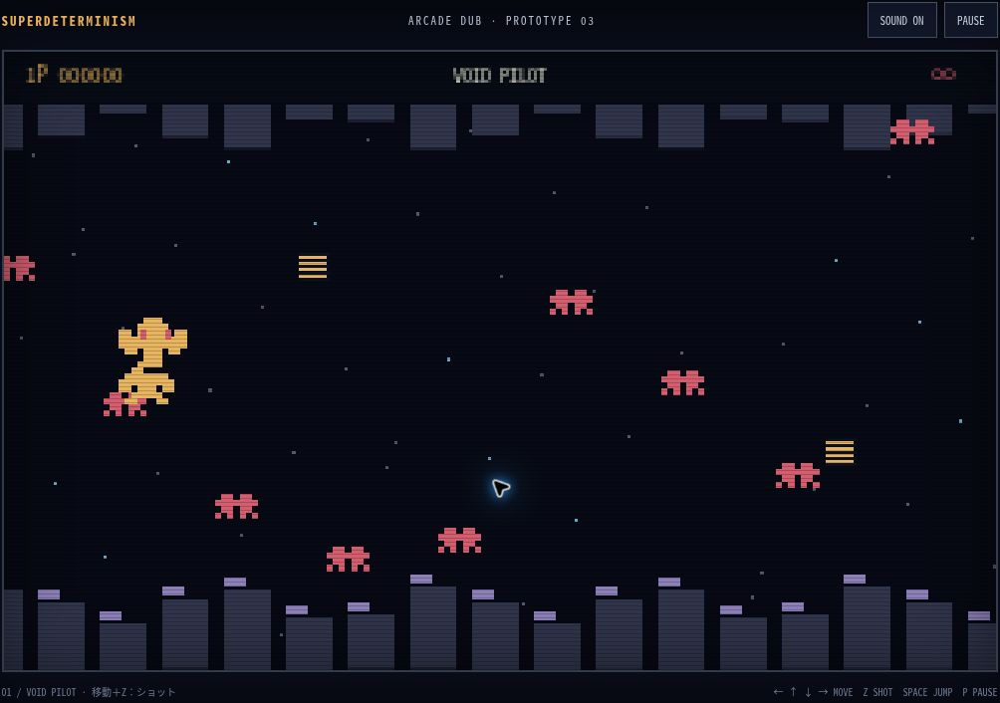

# SUPERDETERMINISM

**悪夢を、遊ぶ。**

▶ **[ブラウザで遊ぶ](https://superdeterminism-dream.sunny-seed-0354.chatgpt.site)**

## この作品について

実際に見た悪夢を出発点に、80年代のアーケードゲームとDUBの感覚で作った短編ブラウザゲームです。

自分の意思で動かしているはずなのに、どこかで何かがずれている。
夢の中では当然だったことが、目覚めたあとには説明できない。
その不条理と不安を、操作する体験として形にしました。

タイトルのSUPERDETERMINISM（スーパーデターミニズム／超決定論）を着想に、
自分で選んでいるという感覚と、自分では支配できない現実のあいだを描きます。

**80s ARCADE × DUB × DECONSTRUCTION**

## 操作

- 矢印キー / WASD：移動
- Z：アクション
- SPACE：ジャンプ / アクション
- P / PAUSE：一時停止
- SOUND：音の切り替え

場面ごとの操作は、画面下の案内を参照してください。
スマートフォンは方向キーとSHOT・JUMPボタンで操作できます。長押しに対応しています。

## 実行方法

`index.html`をブラウザで開き、PRESS STARTを押してください。
HTML・CSS・JavaScriptを一つのファイルに収録しています。
ビルド、外部ライブラリ、APIキーは不要です。音は開始操作後に再生されます。

静的Webサーバー、GitHub Pages、Cloudflare Pagesなどでも配信できます。
現在の公開版は上記のChatGPT SitesのURLです。このリポジトリへの変更はSitesへ自動反映されません。

Prototype 08

Concept / Direction: Masato Nasu  
Created with ChatGPT
